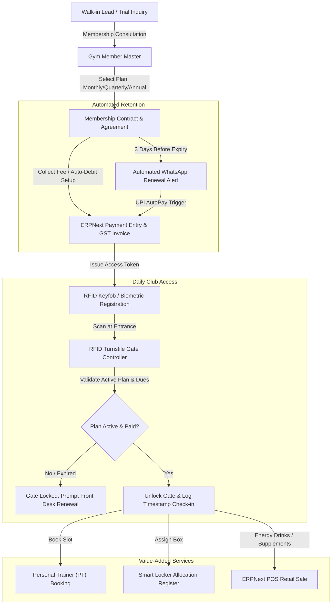

# 🏋️ Frappe Gym & Fitness Club Manager — Membership & Turnstile Access Suite

[](https://frappeframework.com/)
[](https://erpnext.com/)
[]()
[]()
[](LICENSE)

An enterprise **Gym, Health Club & Fitness Studio Management System** built natively on Frappe Framework with direct hardware turnstile integration, subscription recurring billing, and personal trainer scheduling.

---

## 🎯 The Real-World Client Problem & Fitness Club Leakage

Fitness center owners, CrossFit boxes, and premium health clubs suffer significant revenue leakage due to disconnected front-desk practices:
1. **Unauthorized Entry & Tailgating:** Front-desk staff fail to stop expired or unpaid members from entering, leading to overcrowding and loss of subscription renewal revenue.
2. **Untracked Membership Expirations:** Manual register-keeping fails to send timely renewal reminders or trigger automated bank/card recurring debit renewals.
3. **Trainer Scheduling & Commission Disputes:** Personal training (PT) sessions and group fitness classes lack real-time attendance validation, causing trainer commission calculation errors.
4. **Locker Key & Asset Management Loss:** Inability to track assigned smart lockers, guest towel deposits, and nutritional supplement POS sales leads to high operational shrink.

**How This Engine Solves It:** Delivers real-time turnstile relay control (RFID / Biometric), automated subscription billing, PT slot booking, smart locker allocation, and WhatsApp renewal triggers.

---

## 🏛️ End-to-End Gym Member Journey & Architecture



---

## 🚀 Key Engineering Capabilities

- **Turnstile Hardware Relay Integration:** Direct TCP/IP and HTTP relay triggers interfacing with ZKTeco, Matrix, and Hikvision biometric/RFID turnstiles.
- **Subscription Recurring Billing:** Manages flexible membership tiers (Off-Peak, Full Access, VIP, Couples), freeze/pause requests, and auto-prorated renewals.
- **Personal Trainer (PT) Calendar & Commission:** Tracks assigned PT session packs, digital punch redemption upon session completion, and automated trainer commission payout ledgers.
- **Smart Locker & Amenity Assignment:** Manages locker availability, security deposit escrows, and automated clearance warnings for overdue lockers.
- **Direct ERPNext Financial Synchronization:** Automatically posts membership sales, F&B supplement inventory debits, and deferred revenue recognition ledgers.

---

## 📂 Frappe DocType Schema & Data Structure

```text
gym/
├── gym_core/
│   ├── doctype/
│   │   ├── gym_entry/               # Primary Transaction: Member Subscription Contract & Check-in
│   │   │   ├── gym_entry.json
│   │   │   ├── gym_entry.py
│   │   │   └── gym_entry.js
│   │   ├── gym_item/                # Child Table: Membership Benefits, PT Sessions & Lockers
│   │   │   ├── gym_item.json
│   │   │   └── gym_item.py
│   │   ├── gym_settings/            # Configuration: Turnstile IP Endpoints, Grace Periods & Fees
│   │   │   ├── gym_settings.json
│   │   │   ├── gym_settings.py
│   │   │   └── gym_settings.js
│   │   └── gym_audit_log/           # Audit: Tamper-proof Gate Access Log & Manual Override Audit
│   │       ├── gym_audit_log.json
│   │       └── gym_audit_log.py
│   ├── report/
│   │   └── gym_summary/             # MRR, Churn Rate, Peak Hour Footfall & PT Utilization Report
│   │       ├── gym_summary.json
│   │       ├── gym_summary.py
│   │       └── gym_summary.js
│   └── workspace/
│       └── gym_workspace/           # Front Desk Reception Dashboard & Member Fast-Lookup
│           └── gym_workspace.json
├── controllers/                     # Access control state machine & membership validity
├── services/                        # Hardware relay drivers & payment webhook listeners
├── tasks.py                         # Daily midnight membership expiration audit job
└── api.py                           # Whitelisted REST endpoints for member mobile app
```

---

## 🛠️ Installation & Bench Setup

```bash
# 1. Fetch app into Frappe Bench
bench get-app https://github.com/shyampandey1104/frappe-gym-fitness-manager

# 2. Install on your fitness site
bench --site fitness.yourdomain.com install-app gym

# 3. Run database migrations
bench --site fitness.yourdomain.com migrate

# 4. Execute unit test suite
python3 -m unittest discover tests
```

---

## 📄 License
Released under the [MIT License](LICENSE). Built for single studios, multi-location fitness chains, and commercial wellness centers.
